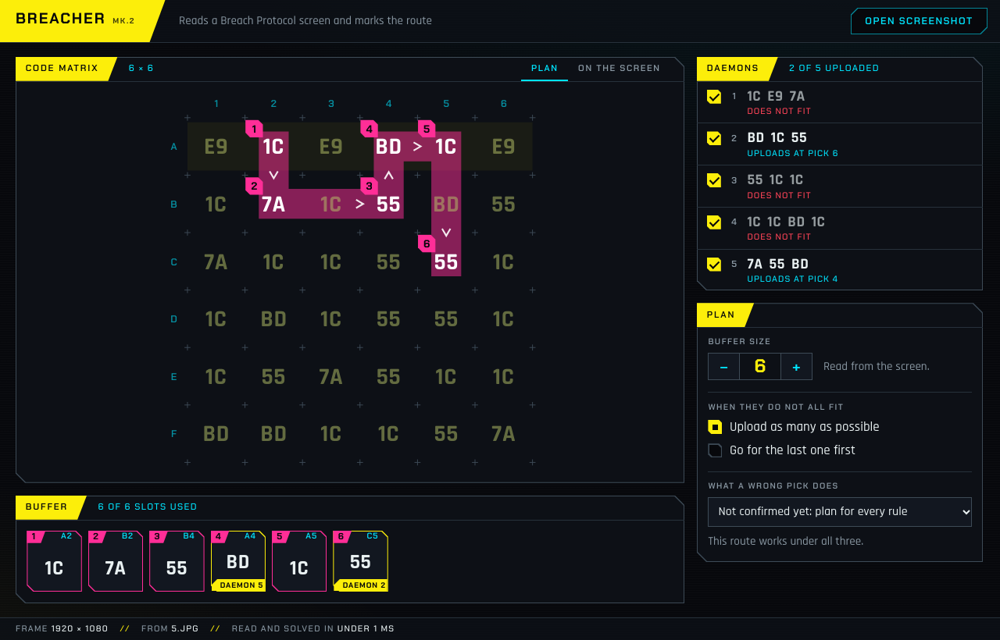

# Breacher

Reads a Cyberpunk 2077 Breach Protocol screen and marks the route: which codes to pick, in which
order, to upload the most daemons the buffer allows.



Open a breach, press a hotkey, and the route appears in the window and, if you want, drawn over the
game. A purpose-built screen reader does the reading in about 13 ms and refuses a frame it cannot
read with confidence instead of guessing. An exact solver then finds the route in well under a
millisecond.

## Run on Windows

The Releases page has two files. The portable one (`…-portable.exe`) runs from wherever you put it,
with nothing to install; it needs the WebView2 runtime, which Windows 11 and an up-to-date Windows 10
already have. The installer (`…-setup.exe`) adds a Start menu entry and fetches that runtime when it
is missing. Neither is code-signed, so SmartScreen asks for confirmation (More info, then Run
anyway). Set the game to Windowed Borderless, open a breach and
press `Ctrl Shift B` before the first pick. The window shows the hotkey in use and lets you change
it. The app keeps a log at `%APPDATA%\dev.breacher.mk2\breacher.log`.

## Updates

An installed copy looks for a newer release when it starts and installs it when you say so; the
update is checked against the project's signature first. The portable copy only tells you and opens
the download page. "Look for updates at start" in the window turns the check off.

## Use

There are three ways to give Breacher a screen:

1. **Hotkey** (`Ctrl Shift B`, `⌘ ⇧ B` on macOS): captures the game window, shows the route in the
   app and, if enabled, draws it over the game. The route stays there until the breach screen
   closes. When another program already holds that
   combination, Breacher takes the next free one and says which; **Change** sets your own.
2. **Watched folder**: point it at the folder where the game, its launcher or the OS saves
   screenshots; new files are read as they appear. Needs no capture permission.
3. **Drop or paste** a screenshot into the window.

Capture before the first pick. A breach that has already started is rejected, not guessed at.

When a capture cannot be read, a line over the game says why for a few seconds, so you need not
leave the game to find out.

Closing the window keeps Breacher in the tray, so the hotkey goes on working while you play. Click
the tray icon to bring the window back, or choose Quit in its menu. "Stay in the tray when closed"
turns this off, and "Start when you sign in" puts Breacher in the tray every time you log on.

The bottom of the window shows which Breacher is running and, after a capture of the game, which
version of the game it looked at. **Save a report** next to them writes the last frame, what was
read from it, the log and those versions into a folder under your documents: attach it to a bug
report.

The same reader and solver are available on the command line:

```
$ breach read screenshot.png
6x6 matrix, buffer 6, 5 daemon(s)   [read 10.8 ms, solved 0.09 ms, frame 1920x1080]

        c1    c2    c3    c4    c5    c6
  r1     E9  1>1C    E9  4>BD  5>1C    E9
  r2     1C  2>7A    1C  3>55    BD    55
  r3     7A    1C    1C    55  6>55    1C
  ...
  upload #2  BD 1C 55 (done at pick 6)
  upload #5  7A 55 BD (done at pick 4)
  picks 6/6: r1c2 1C -> r2c2 7A -> r2c4 55 -> r1c4 BD -> r1c5 1C -> r3c5 55
  works under every matching rule
```

## How it works

The reader takes the brightness of the frame, keeps only thin bright strokes, and finds the code
matrix as the largest regular grid of code-sized marks. The sequence list and the buffer panel are
then located from their structure relative to that grid, not from fixed positions. Codes that look
alike within a frame are grouped before they are named, and a frame is accepted only if every code
passes a confidence gate.

The solver is a depth-first search over legal picks, bounded by a dynamic program over the daemons'
matching automata, and is checked against exhaustive enumeration in the tests.

[ARCHITECTURE.md](ARCHITECTURE.md) describes each stage and the reasons behind it.

One game rule is not confirmed: what happens to a daemon's progress when a pick does not continue its
sequence. Three candidate rules are implemented. By default the planner returns a route that works
under all three, and separately offers a riskier one when plain substring matching would upload more.
**Check the rule with a breach** in the app settles it: Breacher draws a route chosen to tell the
rules apart, you play it and say what uploaded. [docs/RULE-CHECK.md](docs/RULE-CHECK.md) has the
details.

## Accuracy and speed

Measured on an Apple M1 Pro. The corpus is 11 real captures from 2020–21 (720p to 1440p, 16:9, 16:10,
4:3, 21:9, English and Simplified Chinese), 9 readable and 2 not.

| Measure | Result |
|---|---|
| Unmodified captures read exactly (matrix, sequences, buffer) | 9 of 9 |
| Unreadable captures rejected | 2 of 2 |
| Perturbation sweep, 19 conditions × 9 captures, templates learned without the capture under test | 166 of 171 read exactly, 5 rejected, **0 wrong** |
| Matrix cells misread in accepted frames | 0 of 6,951 |
| Composed screens beyond the corpus (5×5 to 8×8, buffers 4 to 12, 1 to 7 daemons, 720p to 4K) | 45 of 45 read exactly |
| Reader time per frame | 13 ms median, 24 ms at the 95th percentile, 15 ms at 4K |
| Solver, 7×7 matrix, buffer 8, 3 daemons | 0.045 ms median |
| Solver, 7×7 matrix, buffer 10, 7 daemons | 0.25 ms median, 8 ms worst |
| Desktop app, screenshot file appears → route shown (1080p PNG, release build) | about 36 ms |
| WebAssembly build, read + solve of a 3440×1440 frame | 22 ms median |

Reproduce:

```sh
cargo test
cargo run --release -p breach-cli -- eval corpus/cpah --loo --full
cargo run --release -p breach-cli -- bench-solver
```

The sweep rescales (720p to 2160p), pads to 21:9 and 32:9, simulates HDR clipping at ×2, ×4 and ×8
and a PQ signal shown as sRGB, shifts gamma, blurs, JPEG-compresses and adds noise. Four of the five
rejections are the 1024×768 and 1152×720 captures under blur or heavy JPEG (three of them only fail
to size the buffer, which the app lets you set); the fifth is the PQ misread at 3440×1440.

The composed screens are built from real glyph crops and follow the reader's own layout model. They
show it handles those sizes and counts consistently, not that the game lays such screens out that way.

## Not verified yet

- **Live capture and the overlay over the running game.** The installer is built and the reader's
  tests pass on Windows in the release pipeline, but capturing the game and placing the overlay over
  it has not been confirmed. The overlay drawing is the same code as the "On the screen" view, which
  is checked against real captures.
- **The current game patch.** The captures are from 2020–21. The reader does not rely on fixed panel
  positions and reports when a screen differs from the usual layout, but a redesigned screen could
  still defeat it.
- **5×5 matrices, and buffers of 4, 5, 7 and above 9.** None are in the corpus. The reader accepts
  3×3 to 9×9 and buffers up to 16 and reads composed screens of those sizes.
- **Real HDR frames.** Capture returns 8-bit frames; on an HDR desktop they arrive over-bright. That
  case is simulated only.
- **The wrong-pick rule**, as described above.

## Build from source

Needs a Rust toolchain with the `wasm32-unknown-unknown` target, and Node.js for the page.

```sh
cargo run --release -p breach-cli -- read corpus/cpah/5.png    # command line

cd app && npm install
npm run dev                                                    # page at http://localhost:1420
npm run tauri dev                                              # desktop app
```

## Repository

```
crates/breach-core      reader, solver, planner; no platform code, also builds to WebAssembly
crates/breach-cli       the `breach` command: read, rule-probe, eval, learn-templates, benchmarks
crates/breach-capture   one-shot screen capture and the permission check
crates/breach-wasm      breach-core behind a plain C ABI for the browser
app/                    the page (TypeScript) and the desktop shell in app/src-tauri
corpus/                 labelled captures the reader is tested against
docs/                   rule check, adding captures, release notes
```

## Contributing

More labelled captures are the most useful contribution, especially from the current patch, at 5×5,
in HDR, and in other languages: see [docs/CORPUS.md](docs/CORPUS.md). For code, start with
[CONTRIBUTING.md](CONTRIBUTING.md).

## Notices

Breacher is not affiliated with, endorsed by or sponsored by CD PROJEKT RED. Cyberpunk 2077 is a
trademark of CD PROJEKT S.A.

The test captures and the typefaces come from other parties under their own licences, listed in
[THIRD-PARTY-NOTICES.md](THIRD-PARTY-NOTICES.md).

## Licence

Licensed under either of

- the Apache License, Version 2.0 ([LICENSE-APACHE](LICENSE-APACHE)), or
- the MIT license ([LICENSE-MIT](LICENSE-MIT)),

at your option.

Unless you explicitly state otherwise, any contribution intentionally submitted for inclusion in
this project by you, as defined in the Apache-2.0 licence, shall be dual licensed as above, without
any additional terms or conditions.
